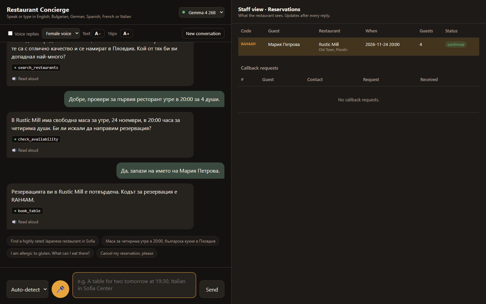

# Multilingual Voice Restaurant Concierge

[](https://github.com/dianj/voice-restaurant-agent/actions/workflows/tests.yml)  

A voice and text AI concierge for a restaurant group. Guests speak or type in English, Bulgarian, German, Spanish, French or Italian. The agent finds restaurants, answers menu and allergen questions, and books, changes or cancels tables. A staff view shows reservations as they are made.

The LLM runs locally in LM Studio and works only through validated tools: it cannot invent a free table or a dish, because availability, menus and bookings come from SQLite through rules written in Python.

<table>
<tr>
<td width="50%"></td>
<td width="50%"></td>
</tr>
<tr>
<td><b>Booking in Bulgarian:</b> search, availability check, and a booking only after the guest says yes. The staff view shows it at once.</td>
<td><b>Allergens in English:</b> the guest switches language mid-conversation; the agent lists only gluten-free dishes and adds the allergy to the booking, marked as changed for the staff.</td>
</tr>
</table>

<sub>Screenshots from a real session with Gemma 4 26B in LM Studio; the tool calls under each reply are the ones the model made.</sub>


## What it does

| Area | Details |
|---|---|
| **Input** | Text, or voice through the browser microphone → local faster-whisper (`large-v3-turbo`). Language detection is limited to the six supported languages, and the guest can fix their language next to the microphone when detection guesses wrong. |
| **Search** | By name, cuisine, city, area, minimum rating, budget and "open at" time (handles places open past midnight). 1,000 restaurants, sorted by rating or by price. Each has a typical price per person in euros, computed from its menu. |
| **Menu & allergens** | Every restaurant has a menu with the 14 EU-declared allergens. Dish and allergen names are stored in all six languages (Шопска салата, Schopska-Salat, …; целина, Sellerie, …), so menus are read in the guest's language without the model translating them. Everyday words ("dairy", "wheat", "shellfish") map to them. The agent names safe dishes and reminds the guest to tell the staff. |
| **Booking rules** | Opening hours and last seating, no past dates, at most 60 days ahead, 1–20 guests (bigger groups go to a human through a callback request), 2-hour sittings that block seats, nearest free times when full. Write lock (`BEGIN IMMEDIATE`) so parallel bookings cannot overbook. Codes like `R34LST` avoid characters that look or sound alike, and the voice spells them out. |
| **Conversation** | Checks availability, reads the details back and books only after the guest confirms; this is enforced in code, not only asked of the model. Before booking it only says a table is *available*. Changing (date, time, party size, allergy notes, another name for the table) or cancelling needs the code and the booking name. A name is added, never replaced, and the staff view marks changed bookings with what changed; the name check tolerates a misheard letter or two and Latin vs Cyrillic spelling, since speech recognition rarely hears a name the same way twice. Today's date is in the prompt, so "tomorrow" or "on Friday" resolve correctly. |
| **Handover to a human** | For events, groups over 20 and anything it cannot do, the agent collects a name, a phone number or email and what it is about, reads them back and, after a yes, saves a callback request that appears in the staff view. It never says it "transferred" a call: an earlier version promised an events team that did not exist. |
| **Voice output** | edge-tts with a male or female voice per language (online Microsoft service). |
| **Models** | Switch between Gemma 4 26B and Qwen 3.8 27B in the UI. Only one fits in GPU memory, so the app unloads one and loads the other through the LM Studio REST API, and never while a guest is waiting for a reply. |
| **Accessibility** | A− / A+ text size (12–24 px) for the conversation and the staff view, remembered per browser. |
| **Robustness** | Per-browser sessions, bounded history, one turn at a time per session. A failed LLM call leaves no half-finished tool exchange. Internal errors are logged and never shown to the guest. |

## Quick start

1. Start **LM Studio's local server on port 1235** with `gemma-4-26b-a4b-it` loaded.
2. Run:
   ```bash
   pip install -r requirements.txt
   uvicorn server:app --host 127.0.0.1 --port 8001
   ```
3. Open `http://localhost:8001`. The demo database is created on first start; `python setup_db.py` rebuilds it (and deletes all reservations).

Environment variables: `LLM_BASE_URL`, `LLM_MODEL`, `WHISPER_MODEL`, `RESTAURANT_DB_PATH`.

## Testing

**74 deterministic tests, about 14 s, no GPU, 87% line coverage** (`pytest --cov`). A scripted fake of LM Studio (`tests/fake_lmstudio.py`) replaces the model and the clock is frozen. CI runs them on every push.

| Suite | What it covers |
|---|---|
| `tests/test_tools.py` (23) | Booking rules (hours, last seating, past dates, 2-hour overlaps, alternatives), changes that do not count the booking itself, ownership checks (including misheard names), added names and change history, callback requests, search and price sorting, allergen filtering, menus and allergens per language, deterministic data |
| `tests/test_api.py` (19) | Full turns over HTTP, booking refused without the guest's yes, a repeated identical call run only once, session isolation, recovery from an LLM outage, internal errors hidden from the guest, tool-loop limit, history trimming, model switching, the chosen speech language |
| `tests/test_voice.py` (16) | Speech language limited to the six supported ones, the guest's choice skipping detection, Whisper loaded once on the CPU, the TTS voice for a typed conversation, Markdown not read aloud and reservation codes spelled out, TTS voice per language and gender, retries and a timeout per attempt (fake Whisper and edge-tts, no network) |
| `tests/e2e/test_ui.py` (16, Playwright) | Tool chips, typing indicator, model output rendered as text (XSS), staff view after booking, changing and cancelling, callback requests, new conversation, outage message, TTS language, model selector and status, text size, speech language |

```bash
pip install -r requirements-dev.txt
python -m playwright install chromium     # or, on Windows with Edge: add --browser-channel msedge
python -m pytest --cov=restaurant --cov=server
```

**LLM evals: does the real model behave?** `python evals/run_evals.py` runs 30 conversations in English, Bulgarian and German against the model in LM Studio, each on fresh data, graded on the reservations in the database, the tool calls and the reply.

| Model (local, LM Studio) | Passed | Median time per turn |
|---|---|---|
| Gemma 4 26B A4B (default) | **60/60** (30 cases × 2 runs) | 8.5 s |
| Qwen 3.8 27B | **59/60** (30 cases × 2 runs); the failure is fixed, see below | 34.5 s |

Writing the evals found real problems, now fixed: a guest naming a restaurant left the agent without its ID (search by name added); Gemma dropped the dash when reading back a code like `R-34LST` (codes have no dash now); late at night Gemma told guests "I confirm your reservation" before booking anything (a prompt rule, checked by an eval that failed 2 of 4 runs before the fix and 0 of 4 after); Qwen sometimes translated restaurant names ("Стар Мил" for "Old Mill"), which a guest could not find; and after a longer prompt Gemma booked straight away when a guest said "Book a table…" (2 of 2 runs), so the confirmation rule moved into code: `book_table` only runs for details that `check_availability` offered in an earlier turn. The Qwen run also showed a privacy gap: looking up a code returned the guest's name, and Qwen said "booked under Maria" to whoever had the code; the lookup no longer returns names. Live tests also showed the agent only offering a colleague when a guest wanted a mistakenly cancelled booking back (now it offers the same table under a new code; 0 of 4 → 6 of 6), and asking "which restaurant?" right after the guest had asked for a restaurant's menu; an eval reproduced it when the conversation also held an earlier reservation (4 of 4 runs) and a prompt rule fixed it (6 of 6). An earlier live test also caught 19:30 being read back as "half past nine". In a live test the agent promised an "events team" that does not exist; the words came from our own prompt and tool text, two evals reproduced it (0 of 6), and both now say "the restaurant staff" (6 of 6). The last full run found that Qwen sometimes sends the same `book_table` call twice in one round, and both ran, so the guest had two tables (1 of 2 runs); an identical call in the same turn is now not run again, and the case passed 4 of 4 runs afterwards, including one where Qwen repeated the call. Per-case results: [`evals/results/latest.md`](evals/results/latest.md).

## Project layout

| Path | Purpose |
|---|---|
| `server.py` | FastAPI endpoints: chat (text or audio), TTS, staff view, health |
| `restaurant/tools.py` | Search, menu, availability, booking, change and cancellation rules |
| `restaurant/tool_schemas.py` | Tool schemas sent to the model |
| `restaurant/registry.py` | The dispatcher that runs tool calls and never raises |
| `restaurant/prompts.py` | The system prompt |
| `restaurant/agent.py` | The tool-calling loop and the booking confirmation gate |
| `restaurant/voice.py` | Speech-to-text and text-to-speech |
| `restaurant/data.py` | Schema and deterministic demo data (also exported to `restaurants_1000.csv`) |
| `index.html` | Single-page UI: conversation and staff view |
| `evals/run_evals.py` | Real-model evaluation |

## Limitations

A local portfolio demo: no authentication on the staff view, sessions in memory, and text-to-speech sends reply text to an online service. A public deployment would need HTTPS, authentication, rate limits and persistent storage.

Architecture, data model, booking rules and gotchas are documented in [docs/ARCHITECTURE.md](docs/ARCHITECTURE.md).

## License

[MIT](LICENSE)
