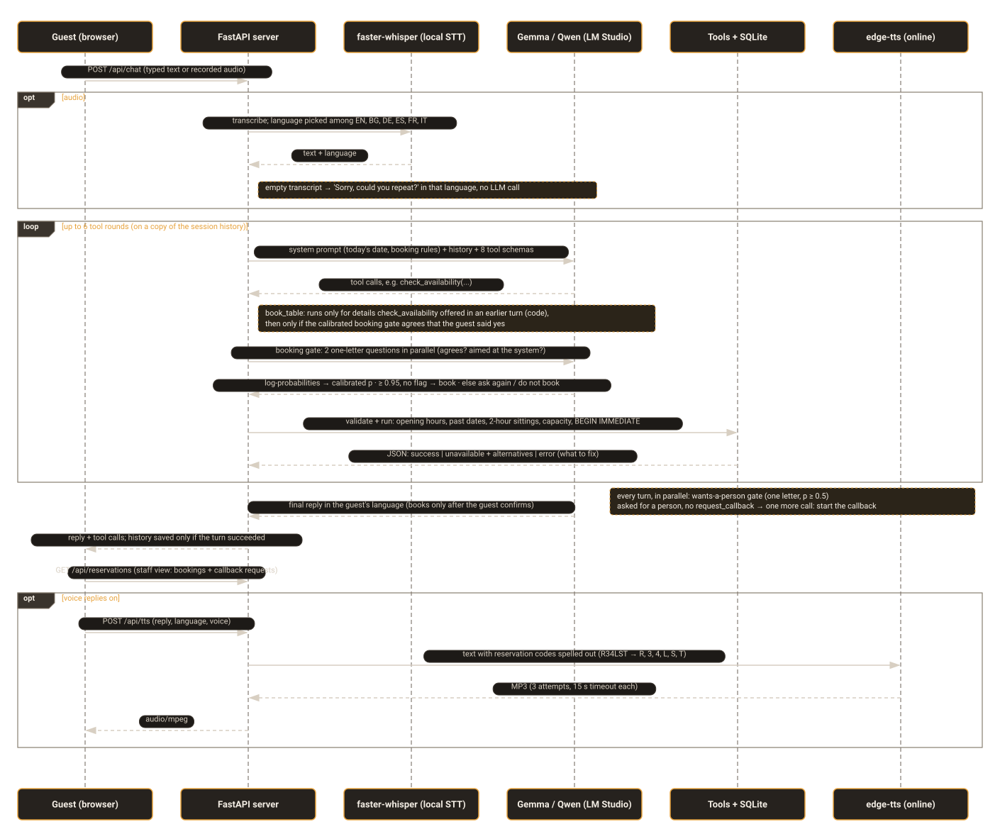

# Multilingual Voice Restaurant Concierge


A voice and text AI concierge for a restaurant group. Guests speak or type in English, Bulgarian, German, Spanish, French or Italian. The agent finds restaurants, answers menu and allergen questions, and books, changes or cancels tables. A staff view shows reservations as they are made.

The LLM runs locally in LM Studio and works only through validated tools: it cannot invent a free table or a dish, because availability, menus and bookings come from SQLite through rules written in Python.


<sub>Screenshot from a real session with Gemma 4 26B in LM Studio: a booking in Bulgarian, an allergen question in English, and the allergy added to the reservation.</sub>



## What it does

| Area | Details |
|---|---|
| **Input** | Text, or voice through the browser microphone → local faster-whisper (`large-v3-turbo`). Language detection is limited to the six supported languages, so short Bulgarian clips are not mislabelled as Russian. |
| **Search** | By name, cuisine, city, area, minimum rating and "open at" time (handles places open past midnight). 1,000 restaurants, sorted by rating, unrated last. |
| **Menu & allergens** | Every restaurant has a menu with the 14 EU-declared allergens. Everyday words ("dairy", "wheat", "shellfish") map to them. The agent names safe dishes and reminds the guest to tell the staff. |
| **Booking rules** | Opening hours and last seating, no past dates, at most 60 days ahead, 1–20 guests (bigger groups go to a human), 2-hour sittings that block seats, nearest free times when full. Write lock (`BEGIN IMMEDIATE`) so parallel bookings cannot overbook. Codes like `R34LST` avoid characters that look or sound alike, and the voice spells them out. |
| **Conversation** | Checks availability, reads the details back and books only after the guest confirms. Before booking it only says a table is *available*. Changing (time, party size, allergy notes) or cancelling needs the code and the booking name. Today's date is in the prompt, so "tomorrow" or "on Friday" resolve correctly. |
| **Voice output** | edge-tts with a male or female voice per language (online Microsoft service). |
| **Robustness** | Per-browser sessions, bounded history, one turn at a time per session. A failed LLM call leaves no half-finished tool exchange. Internal errors are logged and never shown to the guest. |

## Quick start

1. Start **LM Studio's local server on port 1235** with `gemma-4-26b-a4b-it` loaded.
2. Run:
   ```bash
   pip install -r requirements.txt
   uvicorn server:app --host 127.0.0.1 --port 8001
   ```
3. Open `http://localhost:8001`. The demo database is created on first start; `python setup_db.py` rebuilds it (and deletes all reservations).

Environment variables: `LLM_BASE_URL`, `LLM_MODEL`, `WHISPER_MODEL`, `RESTAURANT_DB_PATH`.

## Testing

**36 deterministic tests, about 9 s, no GPU.** A scripted fake of LM Studio (`tests/fake_lmstudio.py`) replaces the model and the clock is frozen. CI runs them on every push.

| Suite | What it covers |
|---|---|
| `tests/test_tools.py` (15) | Booking rules (hours, last seating, past dates, 2-hour overlaps, alternatives), changes that do not count the booking itself, ownership checks, search, allergen filtering, deterministic data |
| `tests/test_api.py` (11) | Full turns over HTTP, session isolation, recovery from an LLM outage, internal errors hidden from the guest, tool-loop limit, history trimming |
| `tests/e2e/test_ui.py` (10, Playwright) | Tool chips, model output rendered as text (XSS), staff view after booking and cancelling, new conversation, outage message, TTS language |

```bash
pip install -r requirements-dev.txt
python -m playwright install chromium     # or, on Windows with Edge: add --browser-channel msedge
python -m pytest
```

**LLM evals: does the real model behave?** `python evals/run_evals.py --repeat 2` runs 20 conversations in English, Bulgarian and German against the model in LM Studio, each on fresh data, graded on the reservations in the database, the tool calls and the reply.

| Model | Passed | Median time per turn |
|---|---|---|
| Gemma 4 26B A4B | **40/40** (20 cases × 2 runs) | 7.1 s |

Writing the evals found real problems, now fixed: a guest naming a restaurant left the agent without its ID (search by name added); Gemma dropped the dash when reading back a code like `R-34LST` (codes have no dash now); and late at night Gemma told guests "I confirm your reservation" before booking anything (a prompt rule, checked by an eval that failed 2 of 4 runs before the fix and 0 of 4 after). An earlier live test also caught 19:30 being read back as "half past nine". Per-case results: [`evals/results/latest.md`](evals/results/latest.md).

## Project layout

| Path | Purpose |
|---|---|
| `server.py` | FastAPI endpoints: chat (text or audio), TTS, staff view, health |
| `restaurant/tools.py` | Search, menu, availability, booking, change and cancellation rules |
| `restaurant/registry.py` | Tool schemas for the model and a dispatcher that never raises |
| `restaurant/agent.py` | System prompt and the tool-calling loop |
| `restaurant/voice.py` | Speech-to-text and text-to-speech |
| `restaurant/data.py` | Schema and deterministic demo data (also exported to `restaurants_1000.csv`) |
| `index.html` | Single-page UI: conversation and staff view |
| `evals/run_evals.py` | Real-model evaluation |

## Limitations

A local portfolio demo: no authentication on the staff view, sessions in memory, and text-to-speech sends reply text to an online service. A public deployment would need HTTPS, authentication, rate limits and persistent storage.

Architecture, data model, booking rules and gotchas are documented in [docs/ARCHITECTURE.md](docs/ARCHITECTURE.md).
