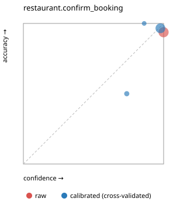

# Calibration: restaurant.confirm_booking

Model `gemma-4-26b-a4b-it`, prompt `3c6207610a11`, 32 labelled cases, fitted temperature **T = 5.127** (2026-11-25).

| | accuracy | ECE | Brier |
|---|---|---|---|
| raw (T = 1) | 0.938 | 0.062 | 0.123 |
| calibrated, 5-fold cross-validated | 0.938 | 0.030 | 0.095 |

Risk-coverage (calibrated): the share of cases at or above each threshold and their accuracy.

| threshold | coverage | accuracy | n |
|---|---|---|---|
| 0.5 | 1.00 | 0.938 | 32 |
| 0.6 | 1.00 | 0.938 | 32 |
| 0.7 | 1.00 | 0.938 | 32 |
| 0.8 | 0.94 | 0.967 | 30 |
| 0.85 | 0.94 | 0.967 | 30 |
| 0.9 | 0.91 | 0.966 | 29 |
| 0.95 | 0.84 | 0.963 | 27 |
| 0.99 | 0.16 | 1.000 | 5 |

Cases labelled *unclear* (graded by action, not label): 6.

