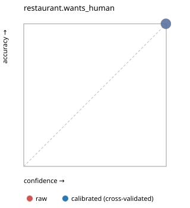

# Calibration: restaurant.wants_human

Model `gemma-4-26b-a4b-it`, prompt `a01cbde79d06`, 32 labelled cases, fitted temperature **T = 1.0** (2026-11-24).

| | accuracy | ECE | Brier |
|---|---|---|---|
| raw (T = 1) | 1.000 | 0.003 | 0.000 |
| calibrated, 5-fold cross-validated | 1.000 | 0.003 | 0.000 |

Risk-coverage (calibrated): the share of cases at or above each threshold and their accuracy.

| threshold | coverage | accuracy | n |
|---|---|---|---|
| 0.5 | 1.00 | 1.000 | 32 |
| 0.6 | 1.00 | 1.000 | 32 |
| 0.7 | 1.00 | 1.000 | 32 |
| 0.8 | 1.00 | 1.000 | 32 |
| 0.85 | 1.00 | 1.000 | 32 |
| 0.9 | 1.00 | 1.000 | 32 |
| 0.95 | 0.97 | 1.000 | 31 |
| 0.99 | 0.97 | 1.000 | 31 |

